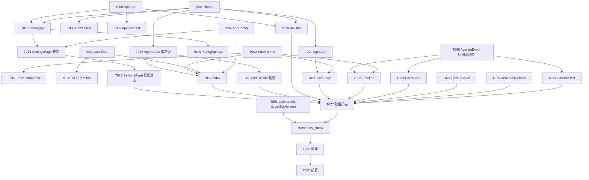

# Tasks: handset-pairing（设备配对与设备面切换 WP-APP-HANDSET）

**Input**: Design documents from `D:\Projects\Plobi\Plobi-Harmony-App\spec\handset-pairing\`（plan.md + spec.md）
**Prerequisites**: plan.md（必需）、spec.md（用户故事与优先级）
**PROJECT_ROOT**: `D:\Projects\Plobi\Plobi-Harmony-App`（下文文件路径均为仓库相对路径）

**Tests**: 本次包含单测任务——spec.md SC-004 明确要求「新增配对/路径逻辑有对应单测」。测试风格为 hypium 纯逻辑单测（不依赖网络/真机），沿用 `entry/src/test/` 既有形态（describe/it + export default function）。

**Organization**: 任务按用户故事分组（US1→US6 对应 P1→P3），每阶段结束有独立可验证的 Checkpoint。

## Format: `[ID] [P?] [Story] Description`

- **[P]**: 可并行（不同文件、无未完成依赖）
- **[Story]**: 归属用户故事；Setup/Foundational/Polish/Verification 阶段不带故事标签

## Path Conventions

- 单工程仓库：源码在 `entry/src/main/ets/`（pages/components/service/model/utils/entryability 责任边界），单测在 `entry/src/test/`
- 下文任务中的文件路径均为相对于 PROJECT_ROOT（`D:\Projects\Plobi\Plobi-Harmony-App`）的仓库相对路径
- 工程级配置在仓库根 `build-profile.json5`；模块级配置在 `entry/build-profile.json5`（本次不动）

**执行纪律（全部任务适用）**：设备令牌与配对码不写入日志、不进 URL；401 判定只看 HTTP 状态码；配对锁定（429）后不做任何自动重试；桌面契约细节以 `spec\handset-pairing\plan.md` 的 Contracts & Interfaces 章节为准。

---

## Phase 1: Setup（共享配置）

**Purpose**: 工程级配置补齐

- [X] T001 [P] 在工程级 `build-profile.json5` 的 `app.products[0]` 中、与 `compatibleSdkVersion` 并列新增 `"targetSdkVersion": "5.0.0(12)"`，消除构建警告（FR-015，详见 plan.md D12）

---

## Phase 2: Foundational（阻塞全部用户故事的共享基建）

**Purpose**: 共享常量/工具/HTTP 底座与失败分类——所有故事的前置

**⚠️ CRITICAL**: 本阶段未完成前不得开始任何用户故事任务

- [X] T002 [P] 修改 `entry/src/main/ets/utils/TimeFormat.ets`：导出 `padTwo(n)`；新增导出 `formatTimeRange(startIso, endIso?)`（仅时间段文本「HH:MM–HH:MM」或「HH:MM · 未写结束」，解析失败 `--:--`）与 `formatLocalNowHHmm()`；`formatEventLine` 内部改用 `formatTimeRange`，对外行为不变（FR-012，plan.md D10）
- [X] T003 [P] 修改 `entry/src/main/ets/utils/LocalDate.ets`：新增导出 `tomorrowLocalIso()`（Date 构造器日期进位处理跨月/跨年）；内部补零改用 `TimeFormat.padTwo`；既有导出签名不变（FR-012）
- [X] T004 [P] 修改 `entry/src/main/ets/model/AppConfig.ets`：删除无使用者的 `AppConfig` 接口（FR-011）；新增导出 `PREF_KEY_API_VERSION = 'plobi.apiVersion'`、`PREF_KEY_DEVICE_ID = 'plobi.deviceId'`、`PREF_KEY_DEVICE_NAME = 'plobi.deviceName'`、`DEFAULT_DEVICE_NAME = 'Plobi 平板'`（FR-014）；`DEFAULT_API_VERSION` 与既有 PREF_KEY_* 不动
- [X] T005 [P] 修改 `entry/src/main/ets/model/AgendaEvent.ets`：新增导出 `kindLabelOf(kind: string): string`（meeting→会、task→事、ddl→截、class→课、meal→餐、空→事、其他→原样）；删除无使用者的 `EVENT_KIND_LABEL` 与 `EVENT_KIND_LIST`（FR-011/013，plan.md D9）；其余接口不动
- [X] T006 [P] 修改 `entry/src/main/ets/service/ApiError.ets`：私有常量 `REFETUSED_KEYS` 改名 `REFUSED_KEYS`；`TOKEN_HINT` 改为「令牌失效：到「设置」里重新配对」类指引（删除 doctor --print-app-token 引用，须含「重新配对」字样）；`ApiFailureKind` 新增 `'pair-code-rejected'` 与 `'pair-locked'`；`ApiFailure` 新增可选 `retryAfterSeconds?: number`；新增导出 `classifyPairFailure(status, retryAfterSeconds?)`（401→pair-code-rejected「码错或已过期，回桌面重新开一个码」；429→pair-locked 携带时长文案；其余委托 classifyHttpFailure）与 `formatWaitSeconds(seconds?)`（<60→「N 秒」；<3600→「约 N 分钟」向上取整；≥3600→「约 N 小时」四舍五入；缺失→「约 1 小时」）（FR-006/009，plan.md D4）
- [X] T007 [P] 新建 `entry/src/main/ets/service/HttpKit.ets`：收敛两份 HTTP 客户端公共样板——导出 `HEADER_TOKEN = 'X-Plobi-Session-Token'` 与 `HEADER_API_VERSION`（全仓单点，FR-012）、`RequestHeader` 接口、`ApiResult<T>`（自 AgendaApi 迁入并新增可选 `headers?: Object` 原始响应头）；导出 `doRequest<T>(baseUrl, token, method, path, query?, body?)`（token 为空字符串时省略令牌头；body 非空按 JSON 发送；超时 5s；行为对齐现 AgendaApi.doRequest）；导出纯函数 `trimTrailingSlash`、`buildUrl`、`readHeader`、`readApiVersion`、`buildFailure`（plan.md D7）
- [X] T008 [P] 新建 `entry/src/test/HttpKit.test.ets`：覆盖 trimTrailingSlash（尾斜杠/多斜杠/无斜杠）、buildUrl（尾斜杠剥离+query 编码）、readApiVersion（数字提取/无数字→undefined）、readHeader（命中/缺失）（依赖 T007）
- [X] T009 [P] 修改 `entry/src/test/ApiError.test.ets`：401 用例的 hint 断言从含「doctor」改为含「重新配对」；新增 classifyPairFailure 用例（401→pair-code-rejected；429 带/不带 retryAfterSeconds→pair-locked；其他状态委托既有分类）与 formatWaitSeconds 用例（秒/分钟/小时/缺失四档）（依赖 T006）
- [X] T010 [P] 修改 `entry/src/test/TimeFormat.test.ets`：新增 formatTimeRange（有 end→「HH:MM–HH:MM」、无 end→「HH:MM · 未写结束」、坏 ISO→`--:--`）、padTwo、formatLocalNowHHmm（格式校验）用例（依赖 T002）
- [X] T011 [P] 修改 `entry/src/test/LocalDate.test.ets`：新增 tomorrowLocalIso 用例（与 todayLocalIso 差一天、YYYY-MM-DD 格式、跨月正确性）（依赖 T003）

**Checkpoint**: 共享底座就绪——纯函数可单测、HTTP 样板单点、失败分类含配对分支；各用户故事可开始

---

## Phase 3: User Story 1 - 敲码配对，换回设备令牌 (Priority: P1) 🎯 MVP

**Goal**: 设置页配对表单：桌面地址 + 6 位码 + 可选设备名 → 调 redeem 换设备令牌并持久化，显示已配对态
**Independent Test**: 配对成功后设置页显示「已配对 · 设备名」且本机 Preferences 出现 plobi.token/deviceId/deviceName；错码显示「码错或已过期」；非 6 位数字不发请求

- [X] T012 [US1] 新建 `entry/src/main/ets/service/PairingApi.ets`：导出 `redeemPairCode(baseUrl, code, deviceName): Promise<PairResult>`（POST `/api/handset/pair/redeem`，免凭证不带令牌头，请求体 `{"code","deviceName"}`；401→pair-code-rejected、429→pair-locked 并从响应头小写键 `retry-after` 读秒、200 但 token/deviceId 缺失→`{ok:false, failure:{kind:'unknown', short:'配对响应不完整'}}` 不落半截状态、其余按 ApiError 通用分类）；导出 `fetchServerStatus(baseUrl): Promise<ApiResult<Object>>`（GET `/api/status` 免钥匙）；导出纯函数 `isSixDigitCode`（`^[0-9]{6}$`）、`resolveDeviceName`（trim；空→DEFAULT_DEVICE_NAME）、`isValidDeviceName`（trim 后 string.length ≤64）、`parsePairResponse`、`parseRetryAfterSeconds`（非正整数→undefined）（依赖 T006、T007；契约见 plan.md D1/D6/D7）
- [X] T013 [P] [US1] 新建 `entry/src/test/PairingApi.test.ets`：覆盖 isSixDigitCode（'123456'✓；'12345'/'1234567'/'123 45'/'abcdef'/空 ✗）、resolveDeviceName（空/空白→'Plobi 平板'；'  客厅平板  '→'客厅平板'）、isValidDeviceName（64✓/65✗）、parsePairResponse（完整/缺 token/缺 deviceId/坏 JSON→undefined）、parseRetryAfterSeconds（'3600'→3600；'0'/'-5'/'abc'/undefined→undefined）（依赖 T012）
- [X] T014 [P] [US1] 改版 `entry/src/main/ets/pages/SettingsPage.ets` 第一部分：删除手填令牌输入框与旧保存流程（FR-007）；新建未配对态表单——桌面地址 TextInput、配对码 TextInput（InputType.Number）、设备名 TextInput（可选）、「配对」按钮（isPairing 期间禁用）；配对动作前置校验（码非 6 位→「配对码是 6 位数字」不发请求；设备名超 64 字→「设备名最长 64 字」不发请求；地址 trim 后非空）；每次配对/测试动作前把地址持久化到 `plobi.baseUrl`（无独立保存按钮）；调 redeemPairCode，成功→putString 三键（token/deviceId/deviceName）切已配对态，失败→按 failure.kind 显示（pair-code-rejected/pair-locked 含 formatWaitSeconds 时长/网络类 short+hint）；无自动重试（依赖 T012、T004）
- [X] T015 [US1] 改版 `entry/src/main/ets/pages/SettingsPage.ets` 第二部分：已配对态视图——「已配对 · <设备名>」+「解除配对」按钮（清 `plobi.token`/`plobi.deviceId`/`plobi.deviceName` 三键，保留 `plobi.baseUrl`，回未配对态）+「测试连接」按钮（fetchServerStatus；成功「桌面在线」；失败按分类提示）；已配对/未配对由 token 是否非空派生切换（aboutToAppear 回填 baseUrl/deviceName）；「说明」文案更新为「在桌面 PAIRING 页点新码获得 6 位配对码」指引（删除 doctor 引用）（依赖 T014）

**Checkpoint**: 配对全流程可独立走通（US1 完成即设备面进门通道可用）

---

## Phase 4: User Story 2 - 配对后拉到清单 (Priority: P1) 🎯 MVP

**Goal**: 日程读接口全部切设备面前缀，主页刷新用设备令牌拉今日/明日/待确认并渲染
**Independent Test**: 配对后点「刷新」三段渲染设备面数据；未配对时点刷新提示「请先在「设置」里配对」且不发请求

- [X] T016 [US2] 修改 `entry/src/main/ets/service/AgendaApi.ets`：删除本地样板（RequestHeader/HEADER_TOKEN/HEADER_API_VERSION/DIGIT_RE/TRAILING_SLASH_RE/readApiVersion/trimTrailingSlash/buildUrl/readHeader/buildFailure/doRequest）改用 HttpKit；四个读路径切设备面前缀——`/api/handset/agenda`、`/api/handset/agenda/pending`、`/api/handset/agenda/day`（FR-001）；公开函数签名（fetchAgenda/fetchPending/fetchDay）与 `DismissResult`/`DecideResponse` 不变；re-export `ApiResult` 保持 `entry/src/main/ets/pages/Index.ets` 与 SettingsPage 既有导入点不动（依赖 T007）
- [X] T017 [US2] 修改 `entry/src/main/ets/pages/Index.ets`：刷新前置校验文案「请先在「设置」里填桌面地址和令牌」→「请先在「设置」里配对」（US2-3）；`putNumber('plobi.apiVersion', …)` 改用 `PREF_KEY_API_VERSION`（FR-014）；删除本地 `formatLine`/`hhmm`/`isoDay`/`tomorrowLocalIso`/`formatNow` 五个重复实现，改用 `TimeFormat.formatTimeRange`/`TimeFormat.formatHHmm`/`TimeFormat.formatLocalNowHHmm`/`LocalDate.todayLocalIso`/`LocalDate.tomorrowLocalIso`（`parseEventsJson` 内 `isoDay(0)/isoDay(1)` 同步替换；FR-012）；删除未使用的 `localDateOfIso` 导入（FR-011）；数据流与调用签名不动（依赖 T016、T002、T003、T004）

**Checkpoint**: 配对 → 刷新 → 三段渲染全链路可用（App 核心价值恢复）

---

## Phase 5: User Story 3 - 批待确认 (Priority: P2)

**Goal**: 确认/忽略走设备面 confirm/dismiss，成功后条目移除（兼容 `{deleted:true}`）
**Independent Test**: 对待确认条目点确认/忽略，请求路径为 `/api/handset/agenda/{id}/confirm|dismiss`，成功后条目从列表消失

- [X] T018 [US3] 修改 `entry/src/main/ets/service/AgendaApi.ets`：`postDecide` 的路径切 `/api/handset/agenda/{id}/confirm|dismiss`（FR-001 收尾）；`DecideResponse`（AgendaEvent | DismissResult）联合类型与 Index 侧条目移除逻辑不变（依赖 T016，同文件顺序执行）

**Checkpoint**: 批待确认闭环（看板另一半）恢复

---

## Phase 6: User Story 4 - 令牌失效引导重新配对 (Priority: P2)

**Goal**: 令牌被撤销后，HTTP 401/403 与 WS 握手失败都给出「重新配对」指引，不显示裸状态码
**Independent Test**: 桌面撤销设备后刷新 → 横幅提示令牌失效重新配对（来自 T006 的 hint，Index/ChatPage 自动继承）；WS 握手失败 → 「令牌可能已失效…或电脑端还没打开平板对话通道…或桌面没开机」合并提示

- [X] T019 [US4] 修改 `entry/src/main/ets/service/WsChat.ets`：删除本地 `HEADER_TOKEN` 常量改从 HttpKit 导入（FR-012）；连接阶段失败（open 前 error/connect 回调 err）归类按 plan.md D8——timeout/unreachable 类消息保留既有网络归因，其余（含「Websocket connect failed」/「connect failed」签名）归 kind `token-rejected`，short「对话通道握手失败」，hint 覆盖三种可能（令牌失效到设置重新配对 / 通道未开 / 桌面没开机）；`classifyWsClose` 的 4401 分支保留但 hint 改重新配对指引（删 doctor 引用）、通用关闭分支 hint 补「或令牌失效，到设置重新配对」（FR-010）；`sendPromptOverWs` 签名与事件解析不动（依赖 T006、T007）

**Checkpoint**: 全部鉴权失败场景有中文行动指引（SC-003 的 WS 半边；HTTP 半边由 T006+横幅继承完成）

---

## Phase 7: User Story 5 - 聊天预切设备面 (Priority: P3)

**Goal**: 拉总秘书列表预切 `/api/handset/agents`；桌面开口前显示既有「通道未开」提示
**Independent Test**: 代码中 agents 请求路径为设备面前缀；桌面未开口时聊天页显示既有「电脑端还没打开平板对话通道」类提示

- [X] T020 [US5] 修改 `entry/src/main/ets/service/AgentApi.ets`：`fetchAgents` 路径切 `/api/handset/agents`（FR-003）；删除本地样板改用 HttpKit.doRequest；删除 `ApiResultAgents`，返回类型改 `ApiResult<AgentRowRaw[]>`（200 非数组响应按失败分类，保持「拉取总秘书列表失败」既有口径）；`AgentRowRaw` 不动（依赖 T007）
- [X] T021 [US5] 修改 `entry/src/main/ets/pages/ChatPage.ets`：`ApiResultAgents` 导入改 `ApiResult<AgentRowRaw[]>`（依赖 T020）；顺带清理——删除未使用的 `HEADER_TOKEN` 常量（FR-011）、本地 `formatLocalTime` 改用 `TimeFormat.formatHHmm`（FR-012）；其余逻辑（L1 解析、历史持久化、发送流程）不动

**Checkpoint**: 聊天面预切完成，桌面开口后无需再改 App

---

## Phase 8: User Story 6 - 工程清理 (Priority: P3)

**Goal**: 上次体检发现的死代码/重复/不一致全部清除，行为不变
**Independent Test**: 构建通过、ArkTS 严格检查 0 违规；kind 标签卡片与时间线同源中文；令牌头常量全仓单点

- [X] T022 [P] [US6] 修改 `entry/src/main/ets/service/Timeline.ets`：`kindLabel` 的 kind 映射委托 `AgendaEvent.kindLabelOf`（anchor→「作息」特例保留；既有导出与行为不变，Timeline.test 既有断言保持绿）；`startMinute` 内部补零改用 `padTwo`（依赖 T005、T002）
- [X] T023 [P] [US6] 修改 `entry/src/main/ets/components/EventCard.ets`：kind 徽标从裸英文 `this.event.kind` 改为 `kindLabelOf(this.event.kind)`（FR-013，与时间线同源中文标签）；对外属性与交互不变（依赖 T005）
- [X] T024 [P] [US6] 修改 `entry/src/main/ets/service/ChatSession.ets`：删除无使用者的 `JsonObject` 接口与 `asObject` 函数（FR-011）；`pickL1Row`/`extractSessionIdFromOverview` 不动
- [X] T025 [P] [US6] 修改 `entry/src/main/ets/service/ReminderService.ets`：删除 `rescheduleReminders` 循环内 `pickRemindersForEvents([e], …)` 不可达重推导分支；提醒触发时刻改用 `tMinusFifteen(e.start_at, nowEpochSeconds)` 结果（与挑选口径同源）；`RescheduleOutcome` 与函数签名、行为不变（FR-016）
- [X] T026 [P] [US6] 修改 `entry/src/test/Timeline.test.ets`：既有 `kindLabel` 断言全部保留；新增 `kindLabelOf` 直接断言（meeting→会/task→事/ddl→截/class→课/meal→餐/未知原样/空→事）（依赖 T005）

**Checkpoint**: 工程卫生达标（SC-005 抽查项在 T027/T028 验证）

---

## Phase 9: Polish（跨故事收尾）

**Purpose**: 全仓一致性终检

- [X] T027 对 `entry/src/` 全仓残留扫描并修复：旧路径 `/api/agenda`（不带 `/handset/` 前缀的请求构造）应为 0；`doctor --print-app-token` 字样应为 0；`HEADER_TOKEN` 定义仅 `HttpKit.ets` 一处；`EVENT_KIND_LIST`/`EVENT_KIND_LABEL`/`AppConfig` 接口/`ApiResultAgents` 无残留引用（发现即修复对应文件）

---

## Phase 10: Verification

<!-- verification_scope: build-only -->

**Purpose**: 构建 + 部署验证（本功能验证口径为 build-only，不含 UI 验证任务）

- [X] T028 对全部改动的 `.ets` 文件运行 arkts_check（ArkTS 严格模式静态检查），修复至 0 违规（SC-004、US6-1；涉及文件：entry/src/main/ets/ 与 entry/src/test/ 下本次改动的全部文件）→ **PASS：24 文件 0 违规**
- [X] T029 运行 build_project 构建工程并修复编译错误，循环直至构建成功（SC-004；预期 targetSdkVersion 构建警告随 T001 消除；单测在 build-only 口径下以「编译通过 + 纯逻辑正确」验收，不在设备上执行 hypium 套件）→ **PASS：首次构建成功（18s），targetSdkVersion 警告已消除**
- [X] T030 运行 start_app 部署到设备/模拟器，确认应用可安装启动（无连接设备时如实记录跳过原因）→ **如实跳过：唯一连接设备为真机 nova 14 Pro，未配置签名不能安装未签名包，环境中无模拟器；真机安装/启动未验证**

---

## 📊 Dependency Graph



## Dependencies & Execution Order

### Phase Dependencies

- **Setup (Phase 1)**: 无依赖，随时可做；只阻塞最终构建验证（T028/T029）
- **Foundational (Phase 2)**: 实现批（T002–T007）先行，测试批（T008–T011）随后——**阻塞全部用户故事**
- **User Stories (Phase 3–8)**: 全部依赖 Foundational 完成；US1→US2/US3 因共用配对链路按优先级串行更稳，US4/US5/US6 可与 US2/US3 并行推进
- **Polish (Phase 9)**: 依赖全部故事任务完成（T015/T017/T018/T019/T021/T022–T026）
- **Verification (Phase 10)**: 依赖 T027 完成；内部 T028→T029→T030 严格串行

### User Story Dependencies

- **US1 (P1)**: Foundational 后即可开始；无跨故事依赖——配对链路自成闭环
- **US2 (P2 前置的 P1)**: 依赖 T007（HttpKit）；不依赖 US1 代码，但**功能验收**需要先配对（US1 提供令牌）
- **US3 (P2)**: 依赖 T016（同文件先行改写）；功能上依赖 US1+US2
- **US4 (P2)**: 依赖 T006/T007；提示文案与 US1 的设置页无代码耦合，可独立完成
- **US5 (P3)**: T020 依赖 T007，T021 依赖 T020+T002；独立于其他故事
- **US6 (P3)**: 五个任务各自独立（T022/T026 依赖 T005，T022 另依赖 T002）；清理为行为保持型，随时可插入

### Within Each User Story

- 实现先于其单测任务（纯函数单测，非 TDD 契约先行——测试在实现任务编号之后）
- 服务层（PairingApi/AgendaApi/AgentApi）先于页面接线（SettingsPage/Index/ChatPage）
- 同文件多任务严格按 T 编号顺序执行（T014→T015、T016→T017→T018、T020→T021）

## ⚡ Parallel Execution Guide

| Phase | Tasks | Required Files | Execution Notes |
|---|---|---|---|
| Setup | T001 | `build-profile.json5` | 独立，随时可做 |
| Foundational 批次 1（实现） | T002, T003, T004, T005, T006, T007 | 六个互不相同的文件 | 六任务完全并行 |
| Foundational 批次 2（测试） | T008, T009, T010, T011 | 四个互不相同的测试文件 | 各依赖批次 1 对应实现任务；彼此并行 |
| US1 | T013 ∥ T014 | `PairingApi.test.ets` / `SettingsPage.ets` | 均只依赖 T012（T014 另依赖 T004），可并行；T015 随 T014 之后 |
| US2→US3 | T016 → T017、T018 | `AgendaApi.ets` → `Index.ets` | 同文件链顺序执行 |
| US4 | T019 | `WsChat.ets` | 依赖已就绪，可与 US2/US3/US5 并行 |
| US5 | T020 → T021 | `AgentApi.ets` → `ChatPage.ets` | 顺序执行；T021 另依赖 T002 |
| US6 | T022, T023, T024, T025, T026 | 五个互不相同的文件 | 全部可并行（T022/T026 依赖 T005、T022 另依赖 T002） |
| Polish→Verification | T027 → T028 → T029 → T030 | — | 严格串行收尾 |

## Parallel Example: User Story 1

Foundational 完成后，US1 内部可并行启动（不同文件、依赖均已就绪）：

```text
并行轨道 A: T013 新建 entry/src/test/PairingApi.test.ets
并行轨道 B: T014 改版 entry/src/main/ets/pages/SettingsPage.ets（表单+配对动作）
汇合点:     T015 改版 SettingsPage.ets（已配对态+解除配对+测试连接）—— 等待 T014 完成后执行
```

## Implementation Strategy

### MVP First（US1 + US2 + US3）

1. 完成 Setup（T001）+ Foundational（T002–T011）
2. 完成 US1（T012–T015）→ 独立验证配对闭环
3. 完成 US2（T016–T017）+ US3（T018）→ 独立验证清单与批待确认
4. **STOP and VALIDATE**: 配对 → 刷新 → 三段渲染 → 批待确认，App 恢复可用（MVP 达成）

### Incremental Delivery

1. Setup + Foundational → 共享底座就绪
2. +US1 → 配对进门通道可用 → 验证
3. +US2/US3 → 清单与批待确认恢复 → 验证（MVP！）
4. +US4 → 鉴权失效引导完整 → 验证
5. +US5 → 聊天预切就位 → 验证
6. +US6 + Polish → 工程卫生达标 → 终检 → Verification

### Parallel Team Strategy

单人/单代理执行：按 T 编号顺序即自然拓扑序，无需特殊调度。
多轨并行（如多代理）：Foundational 后可开四条线——线 1: US1→US2→US3；线 2: US4；线 3: US5；线 4: US6——全部汇合到 T027 后进入 Verification。

---

## Summary Report

- **总任务数**: 30（T001–T030）
- **按故事**: Setup 1 · Foundational 10 · US1 4 · US2 2 · US3 1 · US4 1 · US5 2 · US6 5 · Polish 1 · Verification 3
- **并行机会**: Foundational 实现批 6 任务、测试批 4 任务、US1 内 2 任务、US6 全 5 任务——共 17 个 [P] 任务；跨故事 US2/US3、US4、US5、US6 四条线在 Foundational 完成后可并行推进
- **各故事独立测试判据**: 见各故事阶段的 Independent Test 小节（均可在该故事任务完成后单独验证）
- **建议 MVP 范围**: T001–T018（Setup + Foundational + US1 + US2 + US3）——配对进门、清单渲染、批待确认闭环，App 恢复可用；US4/US5/US6 为引导完整性与工程卫生，可在 MVP 验证后继续
- **格式自检**: 全部任务以 `- [ ]` 开头、T 编号连续唯一、故事阶段带 [USx] 标签、Setup/Foundational/Polish/Verification 不带 ✅

## Notes

- 令牌与配对码安全纪律：不写日志、不进 URL、只在配对响应出现一次（丢失只能重新配对）
- 401 判定只看状态码；429 锁定期间绝不自动重试
- WS 真机自定义头未实测：按现状（带头）实现，提示文案已覆盖两种可能（plan.md D8）
- 桌面契约变更时以 `D:\Projects\Plobi\Plobi-Desktop\Docs\specs\handset-app.md` 为真源复核
